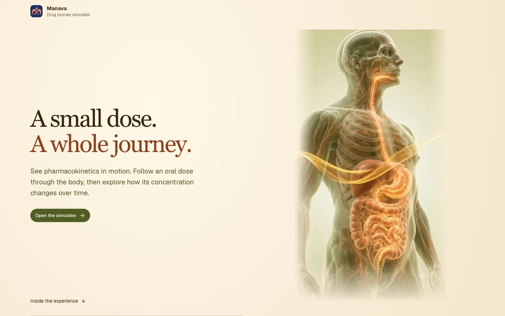
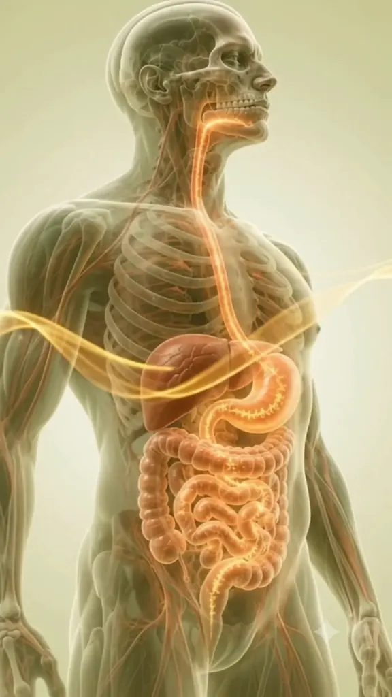
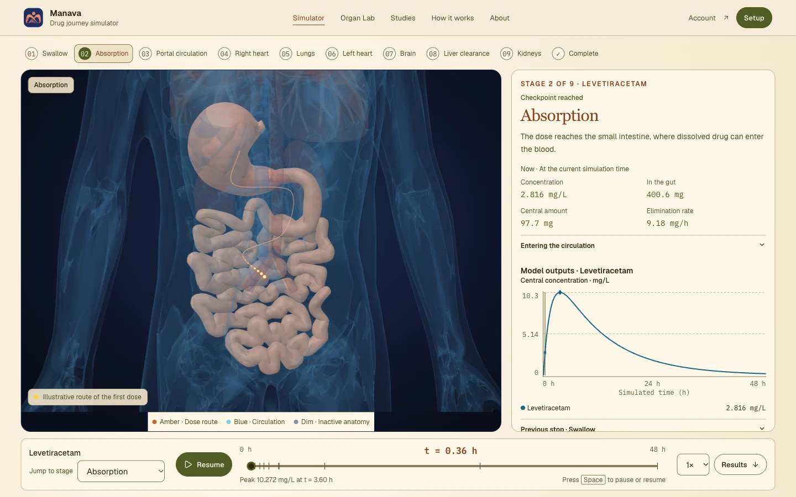
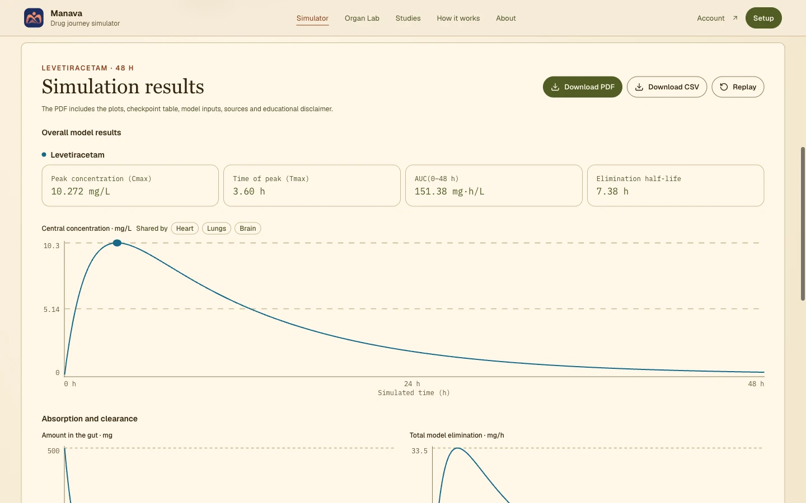
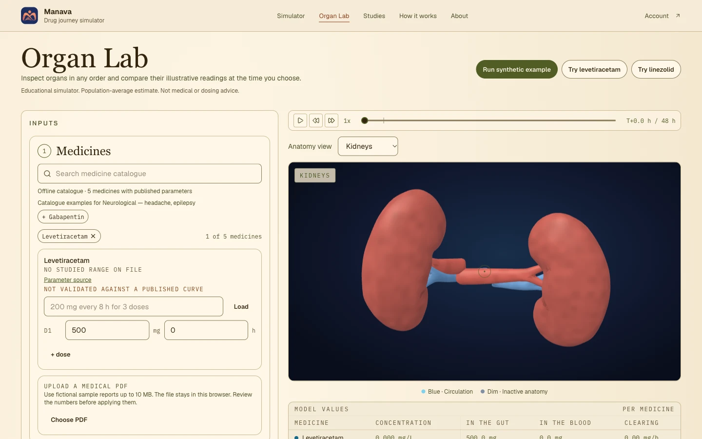

# Anatomy Theatre · Drug-in-Body Simulator

An interactive web simulator for learning oral pharmacokinetics. Follow a dose through a 3D anatomy model, then see how the simulated concentration changes over time and where the input values came from.



## Live Site

[Open Anatomy Theatre on ChatGPT Sites](https://anatomy-theatre.gladbeam1.chatgpt.site)



## Run locally

Use Node.js 24 and npm.

```sh
git clone https://github.com/TatvagnaTandel/Drug-Ingestion-Simulation.git
cd Drug-Ingestion-Simulation
npm ci
npm run dev:web
```

Open [localhost:3000](http://localhost:3000) and choose **Open the simulator**. Select **Levetiracetam** or **Linezolid** and click **Start journey**. Both studies work without an account or API keys. For a custom schedule, open **Custom setup** and add a medicine from the bundled catalogue, or choose **Load synthetic example**. Then select **Run and play**.

## Follow a dose

The camera follows the first scheduled oral dose from swallowing and absorption through circulation, distribution and clearance. It holds its view at each organ stop while the clock and model values update. Use the journey rail to jump to a stage, scrub the timeline, or press **Space** to pause or resume when focus is outside a form control. Use **Inspect an organ** beside the live model outputs to isolate an organ.



## Read and export results

Open **Results** for peak concentration, time to peak, area under the curve and elimination half-life. Each medicine has its own series for central concentration, gut amount and total elimination. **Download CSV** exports the time series. **Download PDF** exports the dose schedule, model inputs, figures, journey checkpoints and source references. The built-in studies cite published adult research and prescribing information.



## Explore organ profiles

Open **Organ Lab** from the navigation to compare reference and adjusted simulations. Explore profiles for the heart, lungs, liver and kidneys, and see how an illustrative change to clearance affects the concentration curve. The lab has a synthetic example that runs without Supabase.

The lab can extract candidate values from a text-based sample PDF. The file and imported values stay in your browser. Review the extracted values before applying them to a draft. The organ profiles and clearance comparisons are teaching scenarios. See the [organ profile data and sources](data/organ-profiles).



## Optional Supabase setup

Supabase enables catalogue search, email sign-in and saving eligible custom reports to an account. To use your own project, apply the SQL files in [supabase/migrations](supabase/migrations) in order and follow the [catalogue import and review instructions](scripts/data/README.md). Add the following placeholders to `apps/web/.env.local`, replace them with your project's values and restart the app.

```dotenv
NEXT_PUBLIC_SUPABASE_URL=https://your-project.supabase.co
NEXT_PUBLIC_SUPABASE_ANON_KEY=your-publishable-or-legacy-anon-key
```

Enable email authentication and allowlist `http://localhost:3000/signin` in Supabase Authentication → URL Configuration. For a deployed app, also allowlist its exact sign-in URL. Keep `apps/web/.env.local` and any root `.env` files local. The browser configuration takes a publishable or legacy anon key.

## Model and limits

The oral model uses one central compartment, first-order absorption and elimination, and an optional absorption lag. The walkthrough illustrates anatomy alongside model-wide estimates. Each medicine is simulated independently. Organ tissue concentrations and drug interactions are outside the model. The Organ Lab uses fictional organ responses and illustrative changes to clearance to teach how the model behaves. Use the simulator for education only.

The local PK reference check currently flags the ibuprofen example. Its simulated time to peak is 1.25 hours against a published reference of 0.79 hours, outside the check's 25% tolerance. The references used for this check are recorded in [data/validation.json](data/validation.json).

## Project map

| Path | What it contains |
| --- | --- |
| [apps/web](apps/web) | Next.js interface, Three.js anatomy and browser PDF export |
| [packages/engine](packages/engine) | Simulation, concentration curves and report metrics |
| [packages/data-client](packages/data-client) | Supabase catalogue, authentication and reports |
| [data](data) and [supabase](supabase) | Reviewed data, validation references and database migrations |
| [docs/PRD.md](docs/PRD.md) and [docs/TRD.md](docs/TRD.md) | Product and technical specifications |

```sh
npm test
npm run typecheck
npm run lint:copy
npm run build:web
```

The anatomy meshes come from BodyParts3D, © The Database Center for Life Science. See the [anatomy attribution and licences](assets/anatomy/README.md#licence).
